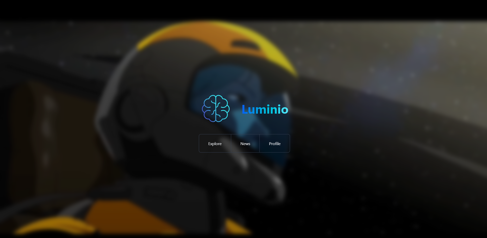
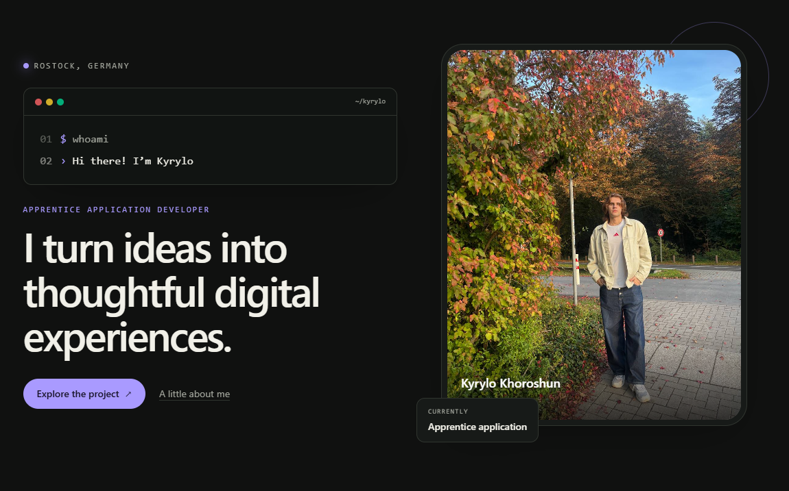

# Kyrylo Khoroshun

### about
﹂Apprentice application developer @ Arvato Systems, Germany 
&nbsp;&nbsp;&nbsp;&nbsp;﹂Fachinformatiker für Anwendungsentwicklung 
&nbsp;&nbsp;&nbsp;&nbsp;﹂currently building a React frontend in one project and a C# backend in another 
﹂Junior Bachelor's degree, Zaporizhzhia Institute of Economics and Information Technologies, Ukraine

### stack

## Featured project

## Featured project

|  |  |
| :---: | :---: |
| **[Luminio](https://web-app-beryl-gamma.vercel.app/)** 3D marketplace/Graduation project | **[kk.](https://my-web-git-master-kirills-projects-585038a6.vercel.app/)** Web Portfolio |
